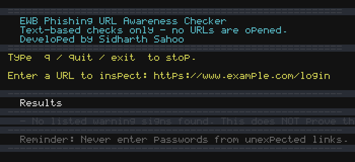
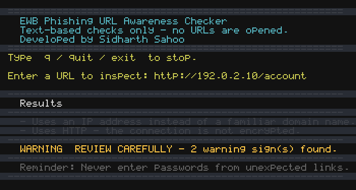
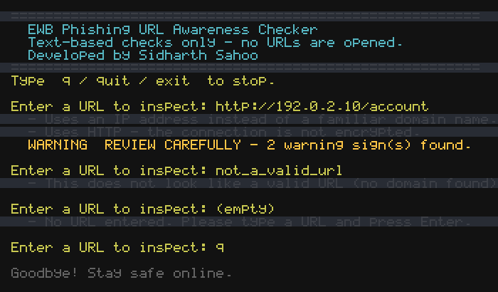

# EWB Phishing URL Awareness Checker

## Overview

Phishing attacks trick people into visiting fraudulent websites that impersonate legitimate services, often to steal credentials, personal data, or financial information. This command-line tool helps raise awareness of common warning signs found in phishing URLs by analysing the visible text of a URL — without opening the link, making network requests, or requiring third-party libraries.

**Objective:** Demonstrate how fundamental text-based analysis can identify suspicious URL patterns and provide beginner-friendly Python practice with functions, loops, validation, and error handling.

---

## Features

The tool checks visible URL text for six common warning signs:

| # | Check | What it looks for |
|---|-------|-------------------|
| 1 | **@ symbol** | An `@` symbol in the URL can obscure the real destination host |
| 2 | **Long URL** | URLs exceeding 100 characters are often used to conceal target destinations |
| 3 | **IP address** | Legitimate services typically use domain names rather than raw IP addresses |
| 4 | **Many subdomains** | Five or more hostname labels may indicate domain spoofing or deep nesting |
| 5 | **Punycode hostname** | `xn--` prefixes indicate Punycode, which can disguise look-alike characters |
| 6 | **HTTP scheme** | Unencrypted plain HTTP connections lack transport encryption |

### Part 10 Improvements

| # | Improvement | Description |
|---|-------------|-------------|
| 1 | **Multiple URL loop** | An interactive `while` loop allows checking multiple URLs in one session; users can enter `q`, `quit`, or `exit` to terminate |
| 2 | **Warning summary** | Displays `⚠ REVIEW CAREFULLY` alongside the exact number of warnings detected whenever suspicious signs are found |
| 3 | **Malformed URL handling** | Catches empty input and invalid URL formats using input validation and `try-except` blocks without crashing |

---

## Requirements

- Python 3.9 or later (verified on Python 3.9.6)
- Standard library only — uses built-in `re` and `urllib.parse` modules (no external packages required)

---

## How to Run

Clone the repository and run the script with Python:

```bash
# macOS / Linux
python3 phishing_checker.py

# Windows
python phishing_checker.py
```

---

## Example Output

```text
=======================================================
  EWB Phishing URL Awareness Checker
  Text-based checks only – no URLs are opened.
  Developed by Sidharth Sahoo
=======================================================
Type  q / quit / exit  to stop.

Enter a URL to inspect: http://192.0.2.10/account

-------------------------------------------------------
  Results
-------------------------------------------------------
  - Uses an IP address instead of a familiar domain name.
  - Uses HTTP – the connection is not encrypted.
-------------------------------------------------------
  ⚠  REVIEW CAREFULLY – 2 warning sign(s) found.
-------------------------------------------------------
  Reminder: Never enter passwords from unexpected links.
-------------------------------------------------------

Enter a URL to inspect: q

Goodbye! Stay safe online.
```

---

## Testing

All tests were executed on **Python 3.9.6** on **macOS**.

### Original Five Test Cases (Part 08)

| # | Input | Expected result | Actual result | Pass/Fail |
|---|-------|-----------------|---------------|-----------|
| 1 | `https://www.example.com/login` | No listed warning signs | No listed warning signs found. This does NOT prove the URL is safe – always verify the source. | ✅ PASS |
| 2 | `http://192.0.2.10/account` | IP address + HTTP (2 warnings) | Uses an IP address instead of a familiar domain name. / Uses HTTP – the connection is not encrypted. ⚠ REVIEW CAREFULLY – 2 warning sign(s) found. | ✅ PASS |
| 3 | `http://example.com@sample.invalid/login` | @ symbol + HTTP (2 warnings) | Contains an @ symbol – the part before @ may not be the real site. / Uses HTTP – the connection is not encrypted. ⚠ REVIEW CAREFULLY – 2 warning sign(s) found. | ✅ PASS |
| 4 | `https://a.b.c.d.e.example.invalid/path` | Many hostname segments (1 warning) | Contains many hostname segments / subdomains. ⚠ REVIEW CAREFULLY – 1 warning sign(s) found. | ✅ PASS |
| 5 | `https://xn--example.invalid/` | Punycode-style hostname (1 warning) | Contains a punycode-style hostname (xn--). ⚠ REVIEW CAREFULLY – 1 warning sign(s) found. | ✅ PASS |

### Part 10 Improvement Test Cases

| # | Input | Expected result | Actual result | Pass/Fail |
|---|-------|-----------------|---------------|-----------|
| 6 | *(empty input)* | Handled gracefully without crash | No URL entered. Please type a URL and press Enter. | ✅ PASS |
| 7 | `not_a_valid_url` | Clear validation message; no crash | This does not look like a valid URL (no domain found). | ✅ PASS |
| 8 | Two URLs in one run | Continuous session without restart | Both URLs inspected sequentially in a single run | ✅ PASS |
| 9 | `q` | Clean termination | Goodbye! Stay safe online. | ✅ PASS |

Detailed test log and reflection: [tests/test_samples.md](tests/test_samples.md)

---

## Screenshots

### Normal URL Analysis (No Warnings)


### Suspicious URL Analysis (Warnings Detected)


### Multiple URL Checking and Edge Cases


---

## Limitations

- This project is strictly an educational tool for visible text patterns.
- It does **not** visit websites, resolve DNS, inspect certificates, scan downloaded content, or check live threat intelligence feeds.
- A clean result with no warning signs does **not** guarantee a URL is benign.
- Many real-world phishing attacks use standard HTTPS links on common domains that will not be caught by simple text checks.

---

## Ethical Use

- Use only sample, synthetic, or authorised test links.
- Do not collect credentials or attempt unauthorized testing on third-party infrastructure.
- Designed solely for educational awareness and secure programming practice.

---

## Author

Sidharth Sahoo – EWB Cybersecurity Project
