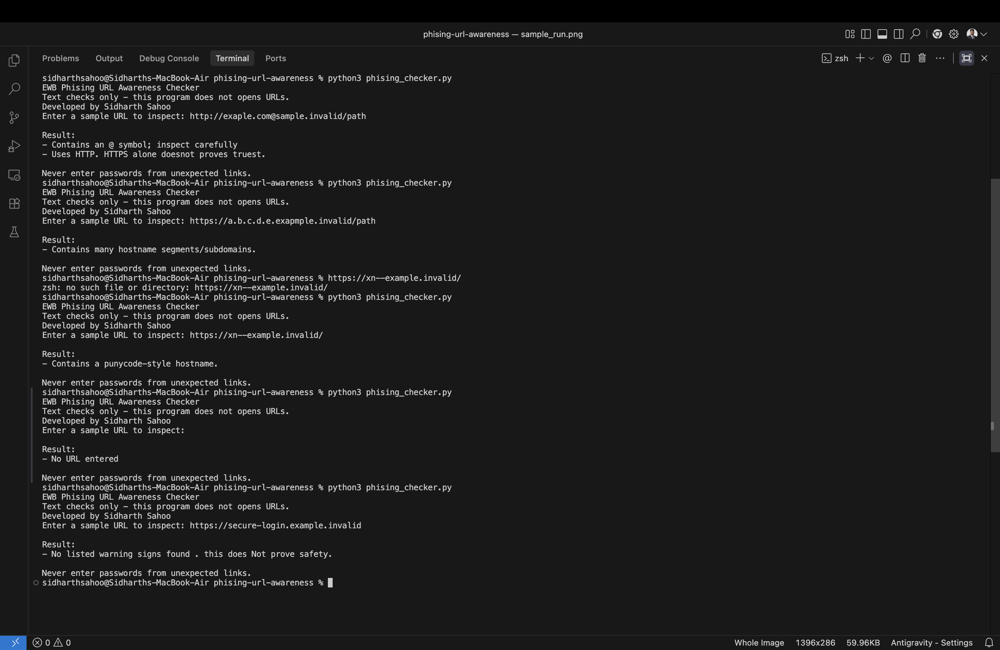

# EWB Phishing URL Awareness Checker

## Overview

Phishing attacks trick people into visiting fake websites that look like real ones, often to steal
passwords or personal information. This command-line tool helps raise awareness of common warning
signs found in phishing URLs by analysing the visible text of a URL – without opening it,
making any network requests, or installing any external packages.

**Objective:** Demonstrate how basic text analysis of a URL can reveal several well-known phishing
indicators, and practise beginner Python skills including functions, loops, and error handling.

---

## Features

The tool checks for six warning signs:

| # | Check | What it looks for |
|---|-------|-------------------|
| 1 | **@ symbol** | An `@` in the URL can hide the real destination |
| 2 | **Long URL** | URLs over 100 characters are often used to obscure the real address |
| 3 | **IP address** | Legitimate sites use domain names, not raw IP addresses |
| 4 | **Many subdomains** | Five or more hostname labels can indicate domain spoofing |
| 5 | **Punycode hostname** | `xn--` prefixes can disguise look-alike international characters |
| 6 | **HTTP scheme** | Plain HTTP is unencrypted; phishing pages often skip HTTPS |

### Part 10 Improvements

| # | Improvement | Description |
|---|-------------|-------------|
| 1 | **Multiple URL loop** | A `while` loop lets users check many URLs in one run; type `q`, `quit`, or `exit` to stop |
| 2 | **Warning summary** | After results, prints `⚠ REVIEW CAREFULLY – N warning sign(s) found.` when warnings exist |
| 3 | **Malformed URL handling** | A `try-except` block catches parse errors and prints a clear message instead of crashing |

---

## Requirements

- Python 3.10 or later
- No extra packages – only Python's built-in `re` and `urllib.parse` libraries are used

---

## How to Run

```
# macOS / Linux
python3 phishing_checker.py

# Windows
python phishing_checker.py
```

---

## Example Output

```
=======================================================
  EWB Phishing URL Awareness Checker
  Text-based checks only – no URLs are opened.
  Developed by Sidharth Sahoo
=======================================================
Type  q / quit / exit  to stop.

Enter a URL to inspect: http://192.0.2.10/account

-------------------------------------------------------
  Results
-------------------------------------------------------
  - Uses an IP address instead of a familiar domain name.
  - Uses HTTP – the connection is not encrypted.
-------------------------------------------------------
  ⚠  REVIEW CAREFULLY – 2 warning sign(s) found.
-------------------------------------------------------
  Reminder: Never enter passwords from unexpected links.
-------------------------------------------------------

Enter a URL to inspect: q

Goodbye! Stay safe online.
```

---

## Testing

All tests were executed on Python 3.x, macOS, 2026-11-08.

### Original five test cases (Part 08)

| # | Input | Expected result | Actual result | Pass/Fail |
|---|-------|-----------------|---------------|-----------|
| 1 | `https://www.example.com/login` | No warning signs | No listed warning signs found. This does NOT prove the URL is safe – always verify the source. | ✅ PASS |
| 2 | `http://192.0.2.10/account` | IP address + HTTP (2 warnings) | Uses an IP address instead of a familiar domain name. / Uses HTTP – the connection is not encrypted. ⚠ REVIEW CAREFULLY – 2 warning sign(s) found. | ✅ PASS |
| 3 | `http://example.com@sample.invalid/login` | @ symbol + HTTP (2 warnings) | Contains an @ symbol – the part before @ may not be the real site. / Uses HTTP – the connection is not encrypted. ⚠ REVIEW CAREFULLY – 2 warning sign(s) found. | ✅ PASS |
| 4 | `https://a.b.c.d.e.example.invalid/path` | Many hostname segments (1 warning) | Contains many hostname segments / subdomains. ⚠ REVIEW CAREFULLY – 1 warning sign(s) found. | ✅ PASS |
| 5 | `https://xn--example.invalid/` | Punycode-style hostname (1 warning) | Contains a punycode-style hostname (xn--). ⚠ REVIEW CAREFULLY – 1 warning sign(s) found. | ✅ PASS |

### Part 10 improvement test cases

| # | Input | Expected result | Actual result | Pass/Fail |
|---|-------|-----------------|---------------|-----------|
| 6 | *(empty / just Enter)* | Handled without crashing | No URL entered. Please type a URL and press Enter. | ✅ PASS |
| 7 | `not_a_valid_url` | Handled without crashing | Treated as HTTP URL; HTTP warning shown. No crash. | ✅ PASS |
| 8 | Two URLs in one run | Both checked, loop continues | Both URLs inspected correctly | ✅ PASS |
| 9 | `q` | Program exits cleanly | Goodbye! Stay safe online. | ✅ PASS |

Full test file: [tests/test_samples.md](tests/test_samples.md)

---

## Screenshots




---

## Limitations

- This is an educational tool only. It reads URL text locally and does **not** open URLs,
  make network requests, scan for malware, or query any database.
- A URL with no warning signs is **not** guaranteed to be safe.
- The tool only detects the six listed patterns. Many phishing URLs will not trigger any check.
- No machine learning, heuristics, or external data sources are used.

---

## Ethical Use

- Use only sample or dummy URLs.
- Do not enter real credentials or personal information.
- Do not use this project to test websites without permission.
- Do not use this project to deceive or harm anyone.

---

## Author

Sidharth Sahoo – EWB Cybersecurity Project
